# CineGL (Android)

[简体中文](README.md) | English

A cinematic camera app that doubles as a study project for **OpenGL ES 3.0 rendering and filters**. Camera frames run through a complete GPU pipeline (lens → film exposure → development and grading → grain), and the live preview, video recording and photos all share the same renderer.

The rendering core is written in C++ (`core/`) and can be unit-tested on a computer without a phone. The Android shell (`app/`) handles Camera2, EGL, MediaCodec and the Compose UI, and calls into the core through a thin JNI layer.

- [UI overview](#ui-overview)
- Features: [Looks](#looks) · [Film effects](#film-effects) · [Log and LUT burn-in](#log-and-lut-burn-in) · [Manual controls](#manual-controls) · [One-tap reset](#one-tap-reset) · [Monitoring tools](#monitoring-tools) · [Aspect ratio, video and photos](#aspect-ratio-video-and-photos)
- Development: [Build and run](#build-and-run) · [Tests](#tests) · [Architecture](#architecture) · [Project layout](#project-layout)
- More: [About the screenshots](#about-the-screenshots) · [Known limitations](#known-limitations) · [Further reading](#further-reading)

## UI overview

<p align="center">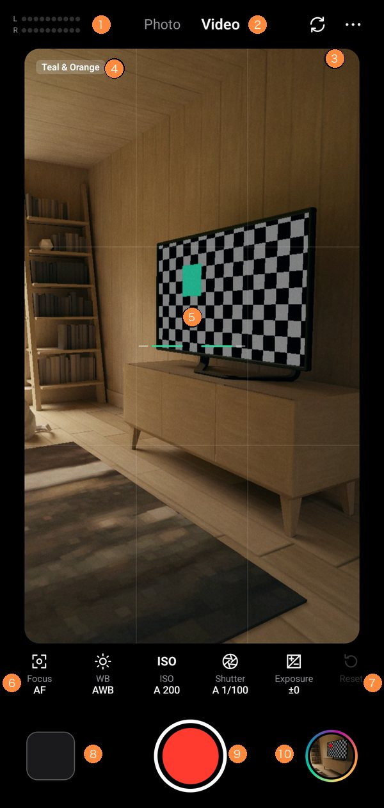</p>

| # | Name | Description |
|:---:|---|---|
| 1 | Audio meter | Left / right microphone levels in video mode |
| 2 | Photo / Video | Switches the capture mode; disabled while recording |
| 3 | Flip · Settings | Switches between the front and back cameras; `···` opens the settings panel. Devices with a flash get an extra torch button on the left |
| 4 | Status chips | The current look; with log on, also `LOG`, `LUT burned in` / `LUT monitor only` and `Log view` |
| 5 | Grid and level | Rule-of-thirds grid; the level's center line stays parallel to the horizon and turns green when level |
| 6 | Manual controls | Focus, white balance, ISO, shutter and exposure compensation. Tap one to open its dial; an orange value means that control is manual |
| 7 | One-tap reset | Lights up when any control is manual; tap it to put everything back on auto |
| 8 | Gallery | Thumbnail of the latest capture; tap to open it in the system viewer |
| 9 | Shutter | Takes a photo in photo mode; starts / stops recording in video mode |
| 10 | Looks | Opens the looks panel; the button shows a live thumbnail of the current look |

Gestures on the preview:

| Gesture | Action |
|---|---|
| Tap | Focus and meter on that point |
| Long press | Cancel tap-to-focus and return to continuous autofocus |
| Pinch | Zoom. On devices with several zoom steps, buttons with 35mm-equivalent focal lengths (e.g. 24 / 49 / 73 mm) appear at the bottom of the frame |

**Language**: the UI follows the system language. It shows Simplified Chinese when the system is set to Simplified Chinese, and English for every other language (Traditional Chinese included).

> Screenshots are from the Android emulator; see [About the screenshots](#about-the-screenshots).

## Features

### Looks

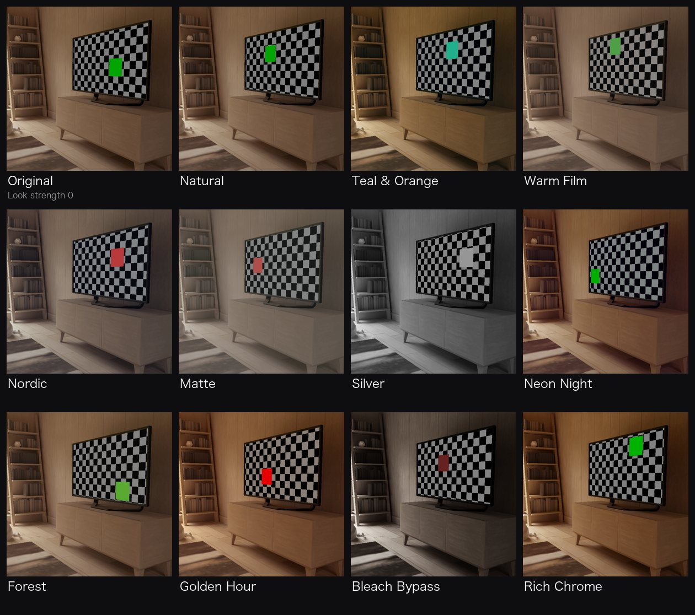

There are 11 built-in looks. Each look is a 33³ 3D LUT, baked on the CPU from a recipe and uploaded to the GPU. The image above shows the same scene with each look applied (all film effects at 0).

| Looks panel | Importing a .cube |
|:---:|:---:|
| 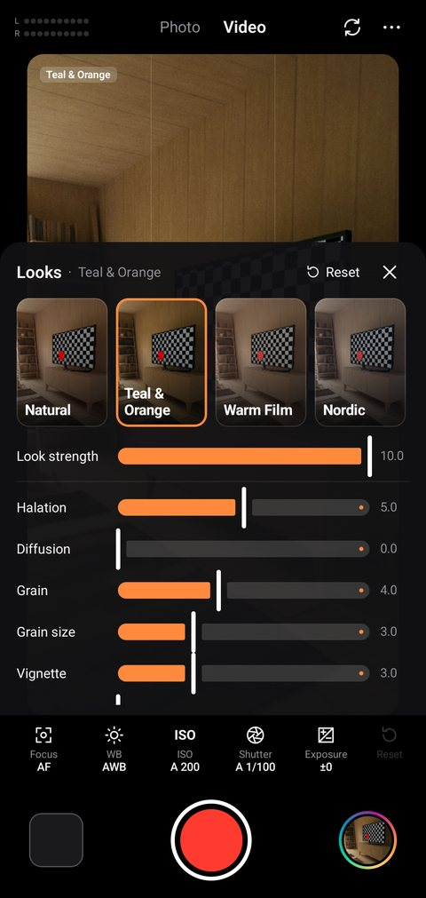 | 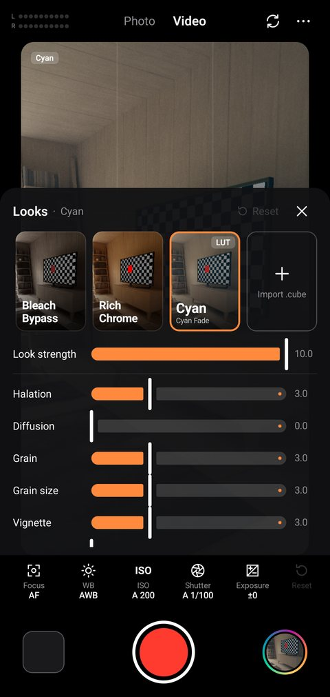 |

- Tap the looks button at the bottom right to open the panel. Every card is a thumbnail of that look applied to the **live** image.
- **Look strength**: continuously adjustable from 0 to 10; 0 means no look.
- **Import .cube**: the last card in the row. Supports 3D LUTs (`LUT_3D_SIZE` 2–256, optionally with `DOMAIN_MIN` / `DOMAIN_MAX`); 1D LUTs are not supported. An imported LUT takes a Rec.709 image as input; with log on, the log signal is converted back to Rec.709 first, so the same LUT looks the same in both modes. Imported cards carry a `LUT` badge in the top-right corner; the file is copied into the app's private storage and loaded automatically on the next launch. If a file can't be parsed, the error message says why (for example, which line is malformed).
- **Reset** (in the panel's title bar): restores look strength and the film effects to their defaults without changing the selected look. Grayed out when everything is already at its default.

### Film effects

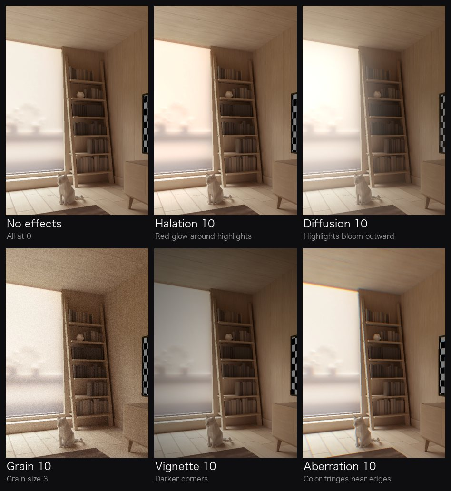

| Effect | What it does | Default |
|---|---|:---:|
| Halation | Emulates film halation: bright areas (linear brightness > 0.8) spill a reddish glow | 3 |
| Diffusion | Emulates a diffusion filter: brighter areas (linear brightness > 0.4) bloom outward and contrast softens | 0 |
| Grain | Adds film grain that changes every frame | 3 |
| Grain size | Size of the grain | 3 |
| Vignette | Lens vignetting following the cos⁴ falloff | 3 |
| Aberration | Lateral chromatic aberration: the red and blue channels drift apart more toward the edges of the frame | 0 |

- Every effect is a continuous value from 0 to 10, adjusted in the looks panel. Changes apply in real time and are included in both recordings and photos.
- Halation and diffusion are computed in linear space (a Dual Kawase blur pyramid, using half-float framebuffers when the device supports them), so only areas that are bright enough will glow.

### Log and LUT burn-in

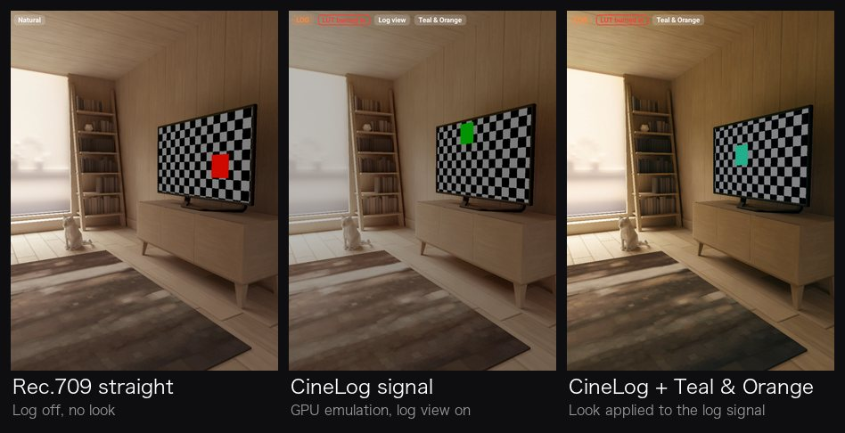

| Log monitoring (log view + waveform) | Settings: aspect ratio, frame rate, log |
|:---:|:---:|
| 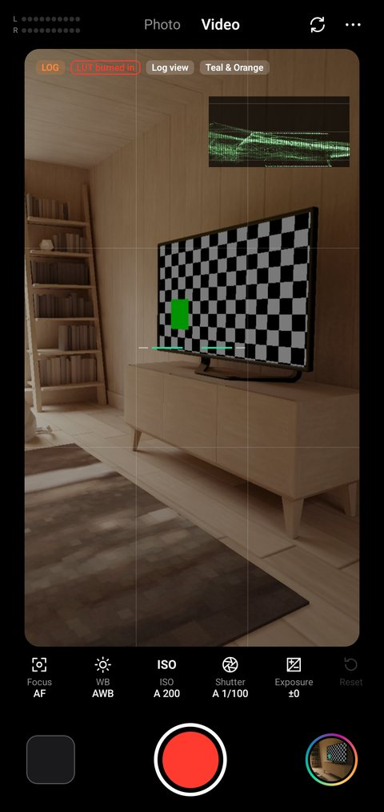 | 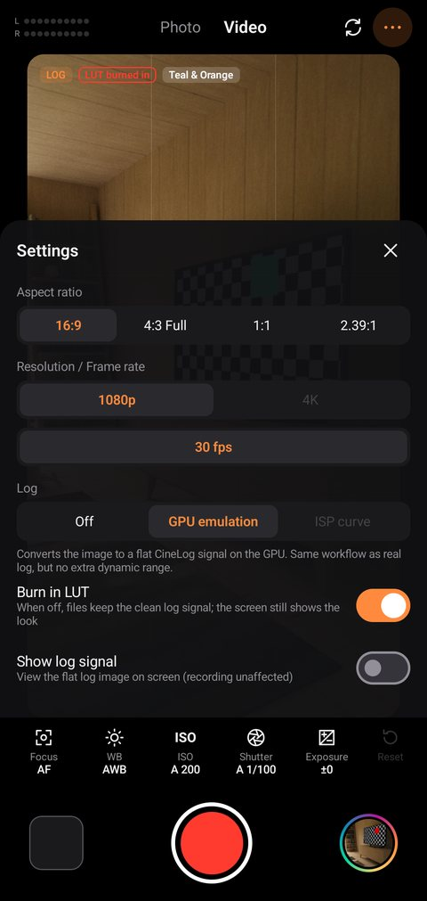 |

Choose a mode under **Settings → Log**:

| Mode | How it works | Requirement |
|---|---|---|
| Off | The camera's Rec.709 image goes straight into the look | — |
| GPU emulation | The lens pass encodes the image as CineLog, and every look then takes CineLog as input. Same workflow as real log, but the dynamic range can't exceed the camera's standard output | None |
| ISP curve | Sends a 64-point curve via `TONEMAP_MODE_CONTRAST_CURVE` so the camera ISP outputs CineLog directly | The device must support tone curves; otherwise this option is grayed out |

The CineLog curve is `y = log2(1 + 63x) / log2(253)`: linear 0 → 0, 18% gray → 0.454, 1.0 → 0.752, 4.0 (+2 stops) → 1.0. Black stays at 0 and the main difference is in the highlights, which is why the window turns visibly gray in the log image above.

With log on, two switches become available:

| Switch | Description |
|---|---|
| Burn in LUT | On by default: recordings and photos store the graded image. When off, files store the clean log signal for grading later, while the screen still shows the look. The status chip shows `LUT burned in` or `LUT monitor only` accordingly |
| Show log signal | Shows the flat log image on screen; doesn't change what's written to files |

### Manual controls

| Manual ISO, shutter derived automatically | Manual white balance (color temperature + tint) |
|:---:|:---:|
| 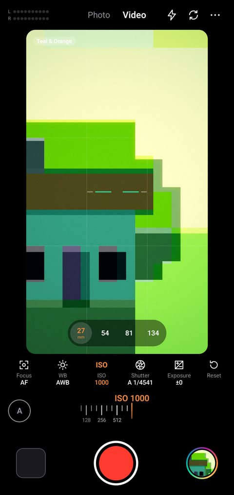 | 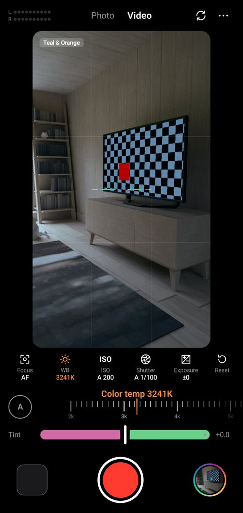 |

Tap a control in the toolbar to open its dial, then drag the scale left or right to change the value. The round button on the left of the dial switches back to auto (for exposure compensation it resets to zero).

| Control | Range | Notes |
|---|---|---|
| ISO | The device's range, 1/3 stop per tick | With only ISO locked, the shutter is derived from the meter reading |
| Shutter | The device's range, 1/3 stop per tick; no slower than one frame when recording, no slower than 1/15 s for photos | With only the shutter locked, ISO is derived; locking both gives full manual |
| Exposure compensation | The device's range | Applies to auto and semi-auto exposure |
| Focus | Infinity to the minimum focus distance | Requires a device that supports manual focus |
| White balance | Color temperature 2000–10000 K, tint −10 to +10 | Gains are adjusted in the ISP when the device supports `MANUAL_POST_PROCESSING`, otherwise on the GPU |

Semi-auto exposure: while AE is running, the app records the metered product `ISO × exposure time ÷ 2^EV`. Once one of the two is locked, the other is the metered product divided by the locked value, clamped to the device's range.

### One-tap reset

| "Reset" lights up when a control is manual | Tapping it puts everything back on auto |
|:---:|:---:|
| 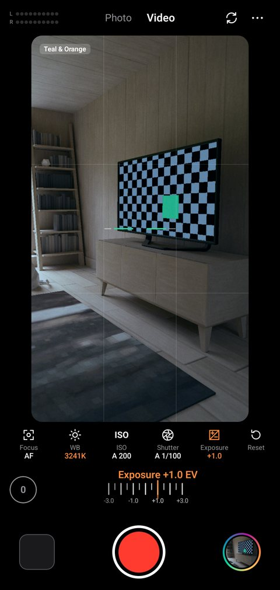 | 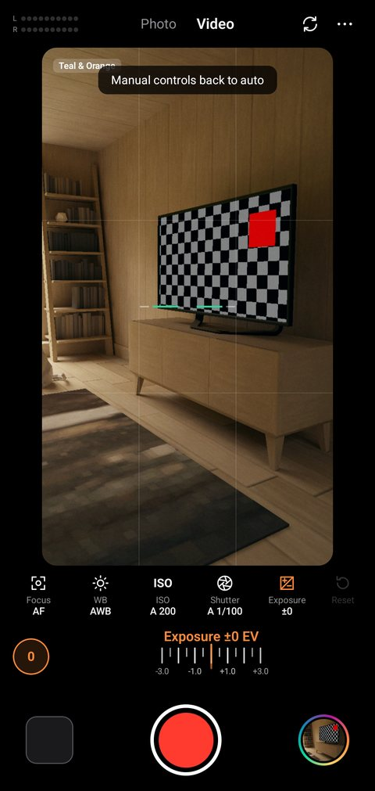 |

**Reset** at the right end of the toolbar:

- Puts focus, white balance, ISO, shutter and exposure compensation back on auto, restores the default color temperature and tint, and clears the focus / metering region set by tap-to-focus;
- Leaves zoom, the torch and stabilization unchanged;
- Is grayed out when every control is already on auto.

Look strength and the film effects are reset from the title bar of the looks panel; see [Looks](#looks).

### Monitoring tools

| Zebra | Focus peaking | Waveform | Settings: monitoring |
|:---:|:---:|:---:|:---:|
| 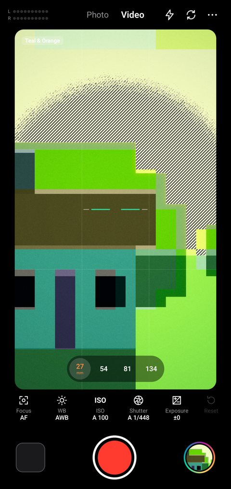 | 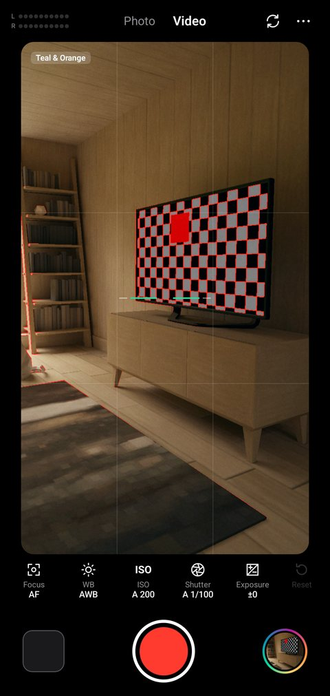 | 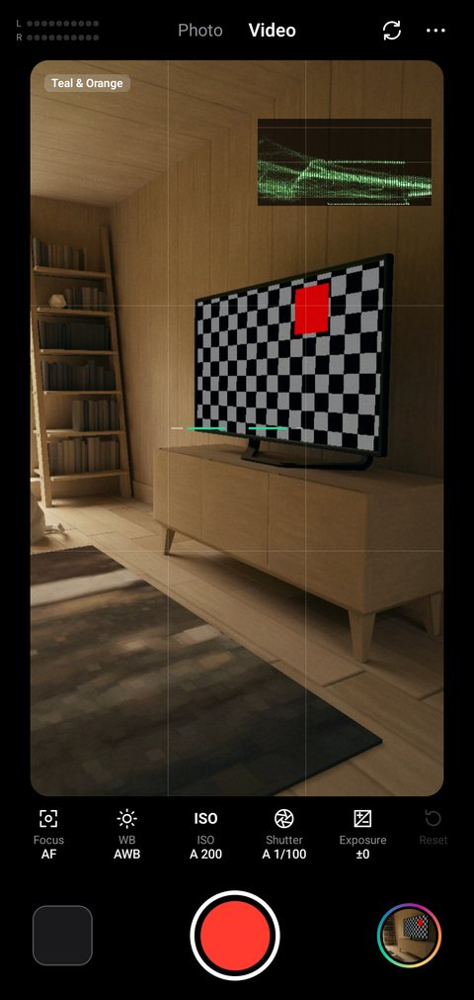 | 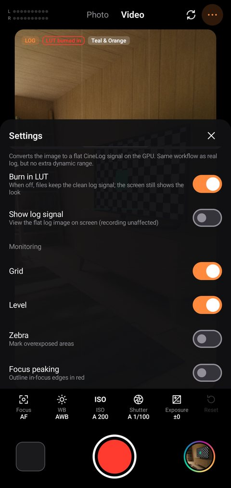 |

Toggle them under **Settings → Monitoring**. They are drawn on screen only and never end up in recordings or photos.

| Tool | Description |
|---|---|
| Grid | Rule-of-thirds lines |
| Level | The center line always stays parallel to the horizon and turns green within 1° of level |
| Zebra | Diagonal stripes mark areas at or above 95% brightness, as an overexposure warning |
| Focus peaking | Outlines in-focus edges in red |
| Waveform | A luma waveform at the top right: the horizontal axis matches horizontal position in the frame, the vertical axis is brightness |

### Aspect ratio, video and photos

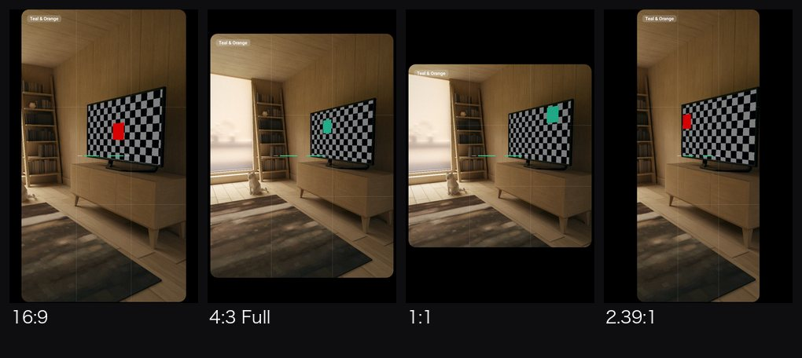

| Recording | Photo mode | Sample photo |
|:---:|:---:|:---:|
| 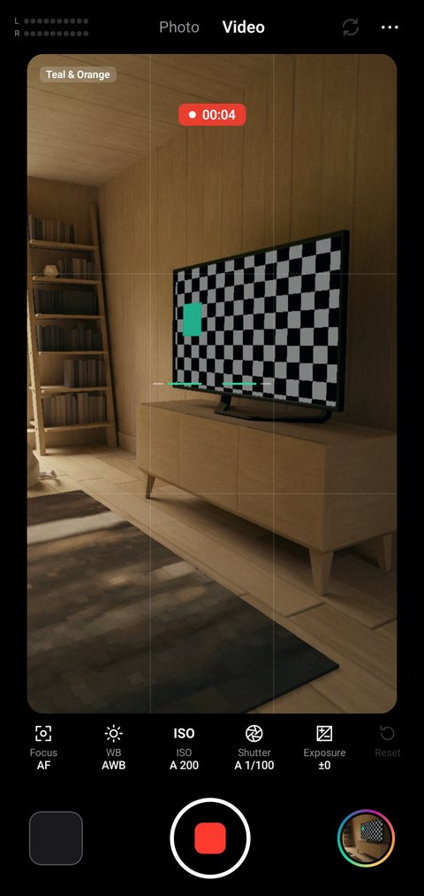 | 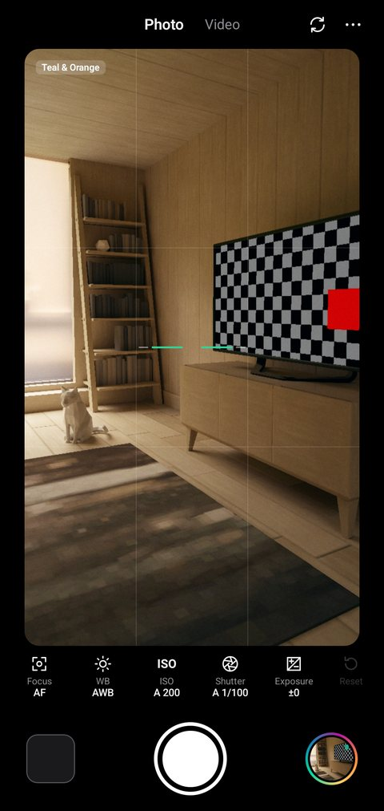 | 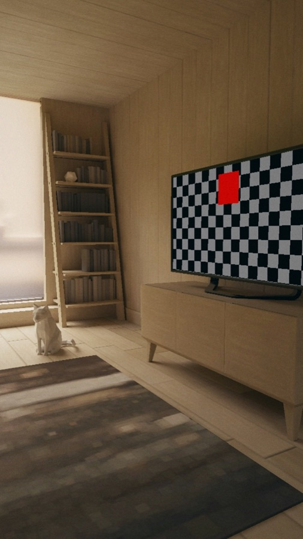 |

| Item | Description |
|---|---|
| Aspect ratio | 16:9, 4:3 full (open gate), 1:1, 2.39:1 — identical in the preview, recordings and photos |
| Video | H.264 + AAC; 1080p / 4K at 24 / 25 / 30 / 60 fps, listed according to what the device supports; audio and video are aligned on the same clock; portrait recordings carry rotation metadata |
| Photos | Captured as a full-resolution 4:3 JPEG, decoded and processed offscreen on the GPU at full resolution (long side capped at 4096), cropped to the selected aspect ratio, rotated upright for the device orientation, with EXIF (ISO, shutter, focal length, aperture) |
| Front camera | Mirrored in the preview, not mirrored in the saved files |
| Other | Continuous torch, stabilization (`PREVIEW_STABILIZATION`, Android 13+ on supported devices), settings are remembered |
| Saved to | The system gallery under `DCIM/CineGL` |

## Build and run

Requirements:

- JDK 17
- Android SDK 36, NDK `27.1.12297006`, CMake `3.22.1` (all available from the SDK Manager in Android Studio)
- Device: Android 11 or later (minSdk 30) with OpenGL ES 3.0; the project only builds `arm64-v8a`

```bash
# Set sdk.dir in local.properties (Android Studio generates it when you open the project)
export JAVA_HOME=$(/usr/libexec/java_home -v 17)   # macOS; on other systems point it at any JDK 17
./gradlew :app:installDebug
```

> Gradle 8.13 and Kotlin 2.1 can't run on JDK 25. If the JDK bundled with Android Studio is 25, set the Gradle JDK to 17 under **Settings → Build, Execution, Deployment → Build Tools → Gradle**.

On first launch the app asks for camera and microphone permissions. Without microphone permission, recordings have no sound.

## Tests

| Command | Covers | Runs on |
|---|---|---|
| `core/scripts/run_host_tests.sh` | C++ core unit tests: the CineLog curve, color math, look baking, `.cube` parsing (including error codes for each failure), frame geometry (crop / rotation / mirroring / output orientation), pass planning, shader embedding | macOS / Linux, no device needed |
| `core/scripts/validate_shaders.sh` | Expands `#include`s and compiles every GLSL shader with the NDK's `glslc`, catching duplicate uniforms, type errors and the like before they reach a device | macOS / Linux, no device needed |
| `./gradlew :app:testDebugUnitTest` | Kotlin unit tests: semi-auto exposure, one-tap reset, stream size selection, zoom presets, orientation snapping, tap-to-focus coordinate mapping, look names following the UI language, bilingual string checks (matching keys and placeholders in both languages, no hard-coded Chinese in code) | JVM |

## Architecture

```
┌──────────────────────────── app (Kotlin) ────────────────────────────┐
│  Compose UI  ──  CameraViewModel                                      │
│                    │            │               │             │       │
│           CameraController  RenderEngine   VideoRecorder  AudioCapture│
│             (Camera2)       (GL thread)    (MediaCodec)   (AudioRecord)│
│                 │   Surface ▲   │  │ EGLSurface ▲               │       │
│                 └───────────┘   │  └────────────┘  PCM ─────────┘       │
│                                 │ JNI (CineCore.kt ↔ cinegl_jni.cpp)    │
└─────────────────────────────────┼──────────────────────────────────────┘
┌─────────────────────────────────▼──────────── core (C++) ──────────────┐
│  Engine (GLES 3.0): lens → halation/diffusion → film → screen /         │
│                     encoder / photo readback                            │
│  CPU only: Color (CineLog) · Looks · LutBaker · CubeLut ·               │
│            FrameGeometry · PassPlan · shaders (embedded at build time)  │
└────────────────────────────────────────────────────────────────────────┘
```

The order in which a frame is processed:

```
Camera ─SurfaceTexture─▶ OES texture
   ─[lens input]────────▶ signal  (aspect crop, aberration, white balance, vignette; CineLog encoding when log is on)
   ─[halation/diffusion]▶ Dual Kawase blur pyramid (linear space, half float)
   ─[film]──────────────▶ graded  (add halation/diffusion → mix neutral LUT and look LUT → grain)
        ├─▶ Screen: rounded corners, peaking, zebra, waveform
        ├─▶ Encoder: rotated for the device orientation; uses signal when LUT burn-in is off
        └─▶ Look thumbnails: one cell per look, packed into an atlas and read back
```

For photos, the decoded JPEG goes through the same pipeline as a 2D texture, using a separate set of full-resolution framebuffers.

## Project layout

| Path | Contents |
|---|---|
| `core/include/cinegl/` | Public headers of the core (no GL types) |
| `core/src/color/` | Color math, look recipes, LUT baking, `.cube` parsing |
| `core/src/geometry/` | Frame cropping, rotation / mirroring matrices, output orientation |
| `core/src/pipeline/` | Pass planning, shader library, GLES engine |
| `core/src/gl/` | GL object wrappers (programs, framebuffers, quad, 3D textures) |
| `core/shaders/` | GLSL ES 3.00 sources (embedded into the binary at build time) |
| `core/tests/` | Host unit tests |
| `app/src/main/cpp/` | JNI bridge |
| `app/src/main/java/com/mycro/cinegl/render/` | EGL, GL thread, LUT scheduling |
| `app/src/main/java/com/mycro/cinegl/camera/` | Camera2 wrapper, manual controls, metering coordinate mapping |
| `app/src/main/java/com/mycro/cinegl/record/` | Video recording, audio capture |
| `app/src/main/java/com/mycro/cinegl/media/` | Saving to the system gallery |
| `app/src/main/java/com/mycro/cinegl/ui/` | Compose UI and ViewModel |
| `app/src/main/res/values*/` | UI strings: English by default, Simplified Chinese in `values-b+zh+Hans` |
| `docs/` | Design notes and screenshots (English screenshots in `docs/images/en/`) |

## About the screenshots

All screenshots in this document come from the Android emulator with the system language set to English:

```bash
emulator -avd <AVD name> -camera-back virtualscene -camera-front emulated
```

- The back `virtualscene` camera is a 3D room at the LIMITED hardware level: its exposure is fixed, and it doesn't support manual ISO / shutter / focus / tone curves, so the UI grays those controls out. The film effects and log comparisons use the 4:3 aspect ratio so the bright window ends up in the frame.
- The front `emulated` camera is an animated color pattern at the FULL level, which can exercise manual controls and semi-auto exposure. The "Manual ISO" and "Zebra" screenshots come from the front camera. `ISP curve` requests do reach it, but the emulated sensor doesn't apply the curve to the pixels, so the effect has to be checked on a real device.
- The GPU pipeline and encoding are slow on the emulator, so recording frame rates are much lower than on a real phone.

## Known limitations

- The flash only works as a continuous torch; there is no flash at the moment of capture (that would need an AE precapture sequence).
- Live photos are not implemented.
- `ISP curve` depends on device support for `TONEMAP_MODE_CONTRAST_CURVE`. Linear values are already clipped at 1.0 before the ISP output, so the log curve changes the encoding (more code values in the shadows, gentler highlights); the upper limit of dynamic range is still set by the sensor.
- Manual white balance is an offset relative to "the AWB result at the moment you switched to manual", around a 5500K reference — not an absolute color temperature.
- Intermediate framebuffers are RGBA8 (the glow pyramid uses RGBA16F when supported), so heavy grading can show banding.
- Video is H.264 only; photos are capped at 4096 on the long side.

## Further reading

- [docs/design-notes.md](docs/design-notes.md): why each step works the way it does, the pitfalls along the way and the ideas that were dropped, plus exercises. Chinese version: [docs/原理与设计取舍.md](docs/原理与设计取舍.md).
