# CineGL（Android）

简体中文 | [English](README.en.md)

电影感相机 App，同时也是一个 **OpenGL ES 3.0 渲染滤镜** 的学习项目。相机画面经过一条完整的 GPU 管线（镜头 → 胶片曝光 → 冲洗调色 → 颗粒），实时预览、录像、拍照共用同一套渲染。

渲染核心用 C++ 编写（`core/`），可以脱离手机在电脑上单测；Android 壳层（`app/`）负责 Camera2、EGL、MediaCodec 与 Compose 界面，通过一层很薄的 JNI 调用核心。

- [界面一览](#界面一览)
- 功能：[影调](#影调) · [胶片效果](#胶片效果) · [Log 与 LUT 烧录](#log-与-lut-烧录) · [手动参数](#手动参数) · [一键重置](#一键重置) · [监看辅助](#监看辅助) · [画幅、录像与拍照](#画幅录像与拍照)
- 开发：[构建与运行](#构建与运行) · [测试](#测试) · [架构](#架构) · [目录结构](#目录结构)
- 其他：[截图说明](#截图说明) · [已知限制](#已知限制) · [进一步阅读](#进一步阅读)

## 界面一览

<p align="center">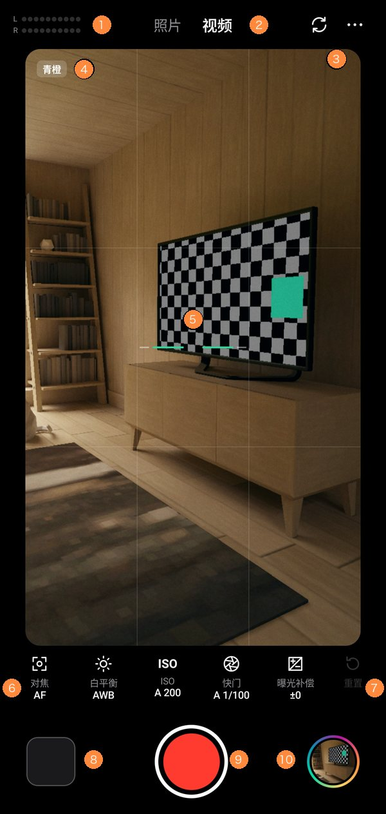</p>

| 序号 | 名称 | 说明 |
|:---:|---|---|
| 1 | 电平表 | 视频模式下显示麦克风左右声道电平 |
| 2 | 照片 / 视频 | 切换拍摄模式，录制中不可切换 |
| 3 | 前后摄 · 设置 | 切换前后摄像头；`···` 打开设置面板。设备有闪光灯时左侧另有补光按钮 |
| 4 | 状态角标 | 当前影调；开启 Log 时另显示 `LOG`、`LUT 烧录` / `LUT 仅监看`、`Log 原片` |
| 5 | 网格与水平仪 | 三分线；水平仪中线与地平线保持平行，对齐时变绿 |
| 6 | 手动参数 | 对焦、白平衡、ISO、快门、曝光补偿。点击展开刻度盘，数值为橙色表示该项处于手动 |
| 7 | 一键重置 | 有手动参数时亮起，点击后全部恢复自动 |
| 8 | 相册 | 最近一次拍摄的缩略图，点击用系统应用打开 |
| 9 | 快门 | 照片模式下拍照；视频模式下开始 / 停止录制 |
| 10 | 影调 | 打开影调面板，按钮显示当前影调的实时缩略图 |

预览区手势：

| 手势 | 作用 |
|---|---|
| 单击 | 在该点对焦并测光 |
| 长按 | 取消点击对焦，恢复连续对焦 |
| 双指缩放 | 变焦。设备支持多档变焦时，画面底部显示 35mm 等效焦距按钮（如 24 / 49 / 73 mm） |

**界面语言**：跟随系统。系统为简体中文时显示中文，其他语言（包括繁体中文）一律显示英文。

> 截图来自 Android 模拟器，见[截图说明](#截图说明)。

## 功能

### 影调

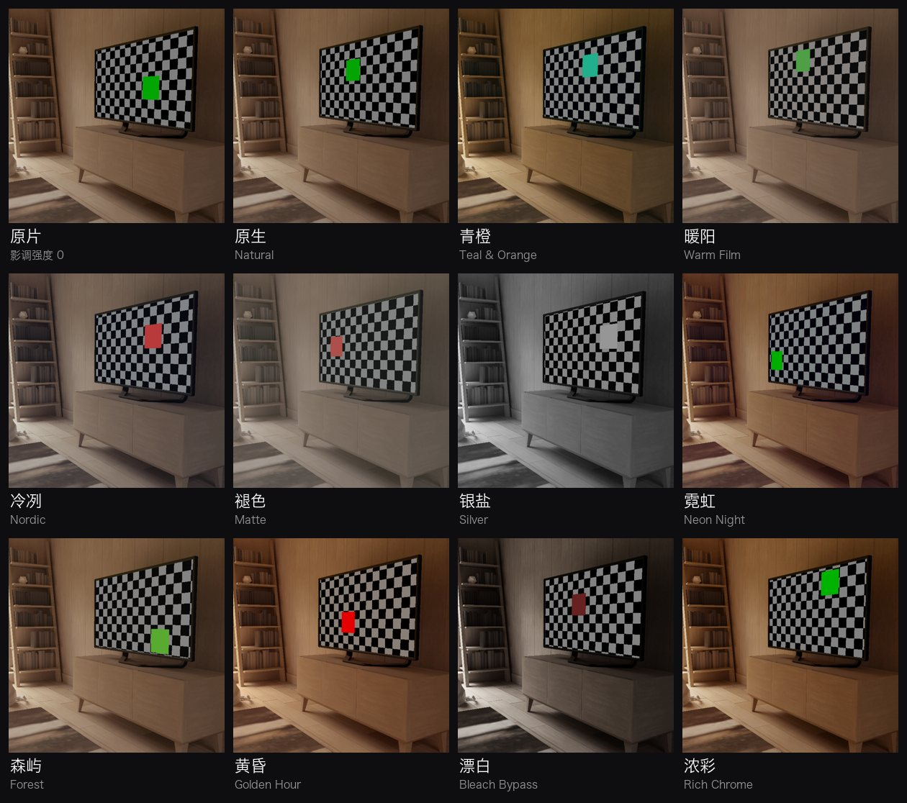

内置 11 个影调。每个影调是一张 33³ 的 3D LUT，由 CPU 按配方烘焙后上传 GPU。上图是同一场景分别套用各影调的效果（胶片效果均为 0）。

| 影调面板 | 导入 .cube |
|:---:|:---:|
| 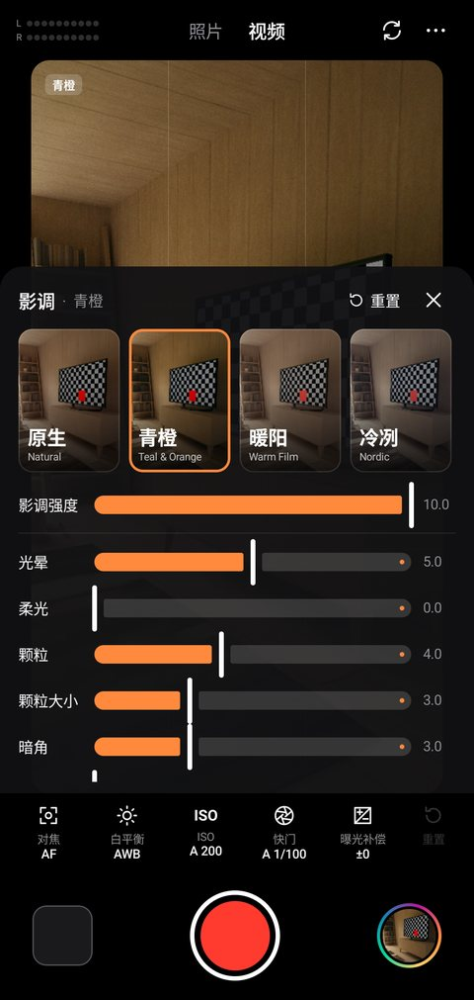 | 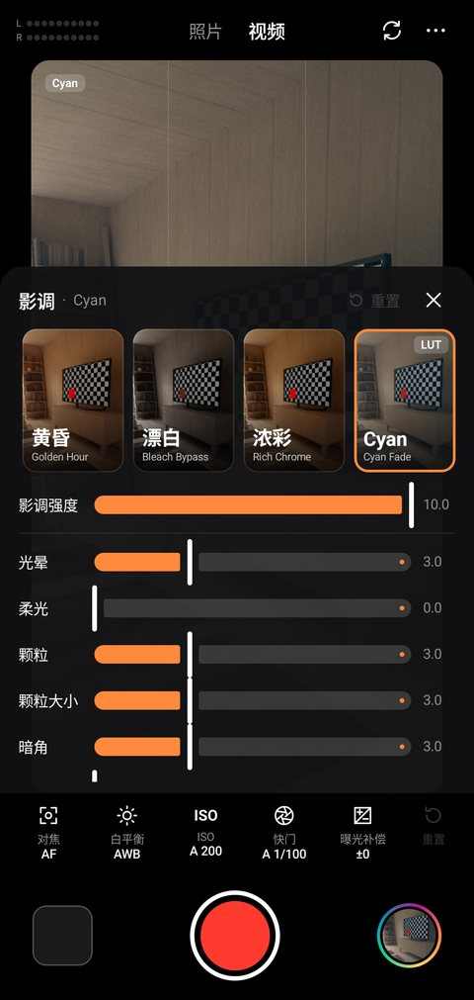 |

- 点击右下角的影调按钮打开面板。每张卡片都是该影调作用在**实时画面**上的缩略图。
- **影调强度**：0–10 连续可调，0 表示不套用影调。
- **导入 .cube**：位于卡片列表末尾。支持 3D LUT（`LUT_3D_SIZE` 2–256，可带 `DOMAIN_MIN` / `DOMAIN_MAX`），不支持 1D LUT。导入的 LUT 以 Rec.709 画面为输入，开启 Log 时会先把 Log 转回 Rec.709 再套用，所以同一个 LUT 在两种模式下效果一致。导入后卡片右上角标 `LUT`，文件复制到应用私有目录，下次启动自动加载。文件无法解析时，提示里会写明原因（例如第几行格式不对）。
- **重置**（面板标题栏）：影调强度与胶片效果恢复默认，所选影调不变。全部为默认值时置灰。

### 胶片效果

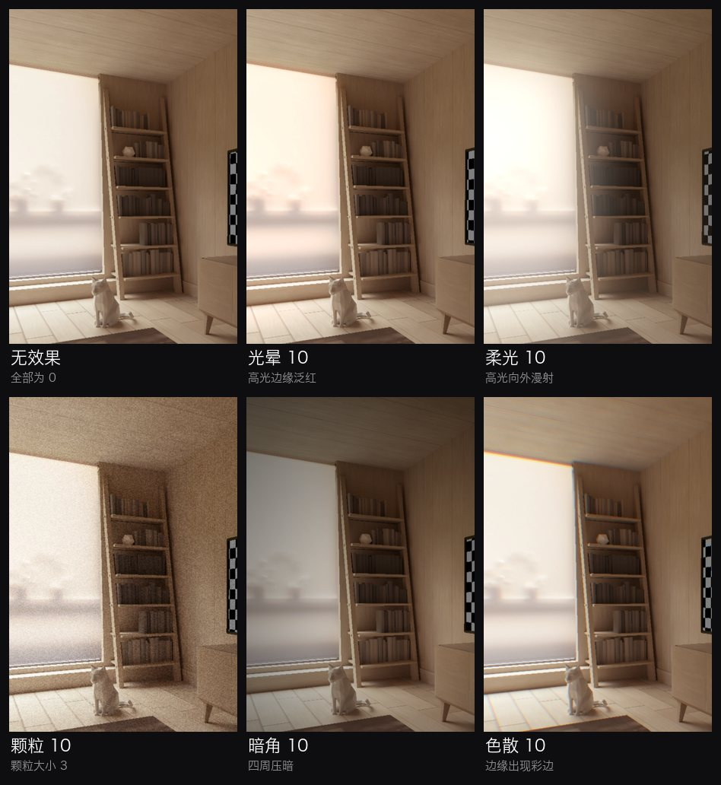

| 效果 | 作用 | 默认值 |
|---|---|:---:|
| 光晕 | 模拟胶片的 halation：亮部（线性亮度 > 0.8）向外泛出偏红的光 | 3 |
| 柔光 | 模拟柔光镜：较亮区域（线性亮度 > 0.4）向四周漫射，反差降低 | 0 |
| 颗粒 | 叠加随帧变化的胶片颗粒 | 3 |
| 颗粒大小 | 颗粒的尺寸 | 3 |
| 暗角 | 镜头暗角，按 cos⁴ 规律向四周衰减 | 3 |
| 色散 | 镜头横向色差：越靠近画面边缘，红、蓝通道错位越明显 | 0 |

- 所有效果都是 0–10 的连续值，在影调面板中调节，实时生效，录像和拍照都会带上。
- 光晕与柔光在线性空间中计算（Dual Kawase 模糊金字塔，设备支持时使用半精度浮点帧缓冲），只有足够亮的区域才会发光。

### Log 与 LUT 烧录

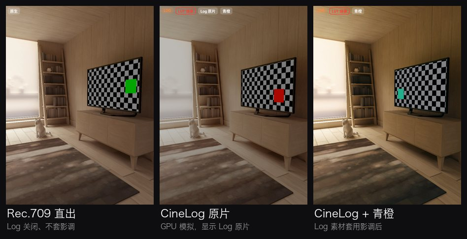

| Log 监看（Log 原片 + 波形图） | 设置：画幅、帧率、Log |
|:---:|:---:|
| 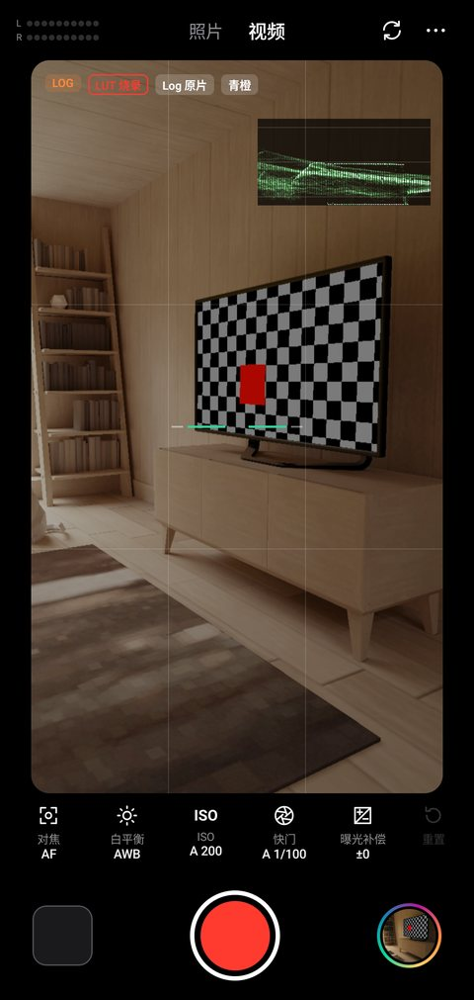 | 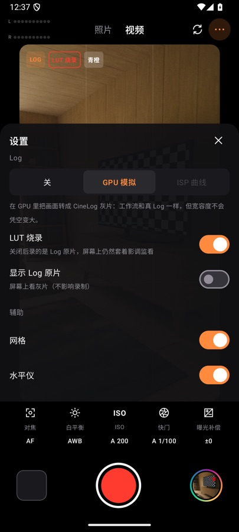 |

在 **设置 → Log** 中选择：

| 模式 | 原理 | 要求 |
|---|---|---|
| 关 | 相机直出的 Rec.709 画面直接进入影调 | — |
| GPU 模拟 | 在镜头 pass 中把画面编码为 CineLog，之后的影调都以 CineLog 为输入。工作流与真 Log 相同，但宽容度不会超过相机直出 | 无 |
| ISP 曲线 | 通过 `TONEMAP_MODE_CONTRAST_CURVE` 下发 64 点曲线，由相机 ISP 直接输出 CineLog | 设备支持色调曲线，否则该项置灰 |

CineLog 曲线为 `y = log2(1 + 63x) / log2(253)`：线性 0 → 0，18% 灰 → 0.454，1.0 → 0.752，4.0（+2 档）→ 1.0。黑位仍在 0，主要差别在高光，所以上图中窗户在 Log 原片里明显变灰。

开启 Log 后有两个开关：

| 开关 | 说明 |
|---|---|
| LUT 烧录 | 默认开启，录像和照片写入套用影调后的画面。关闭后写入 Log 原片，便于后期调色，屏幕上仍套用影调监看。角标随之显示 `LUT 烧录` 或 `LUT 仅监看` |
| 显示 Log 原片 | 屏幕上直接显示 Log 灰片，不影响写入文件的内容 |

### 手动参数

| 手动 ISO，快门自动推算 | 手动白平衡（色温 + 色调） |
|:---:|:---:|
| 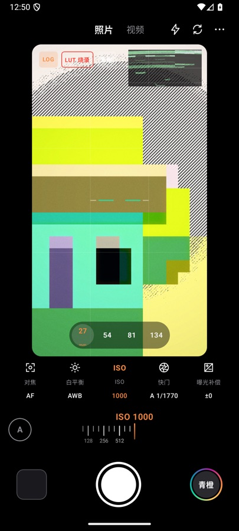 | 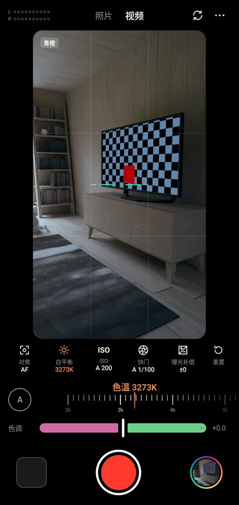 |

点击工具栏中的参数展开刻度盘，左右拖动刻度调值；刻度盘左侧的圆形按钮切回自动（曝光补偿为归零）。

| 参数 | 范围 | 说明 |
|---|---|---|
| ISO | 设备支持的范围，每格 1/3 档 | 只锁定 ISO 时，快门按测光结果自动推算 |
| 快门 | 设备支持的范围，每格 1/3 档；录像时不慢于一帧的时长，拍照时不慢于 1/15 s | 只锁定快门时，ISO 自动推算；两项都锁定为全手动 |
| 曝光补偿 | 设备支持的范围 | 在自动和半自动曝光下生效 |
| 对焦 | 无穷远到最近对焦距离 | 需要设备支持手动对焦 |
| 白平衡 | 色温 2000–10000 K，色调 −10 – +10 | 设备支持 `MANUAL_POST_PROCESSING` 时在 ISP 中调增益，否则在 GPU 中调整 |

半自动曝光：AE 工作时记录测光乘积 `ISO × 曝光时间 ÷ 2^EV`；锁定其中一项后，另一项由测光乘积除以锁定值得到，并限制在设备范围内。

### 一键重置

| 有手动参数时「重置」亮起 | 点击后全部恢复自动 |
|:---:|:---:|
| 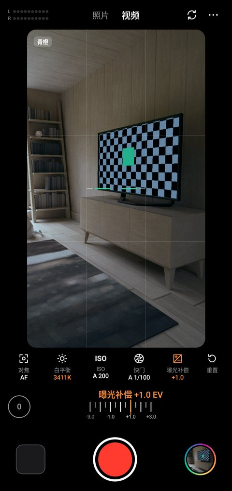 | 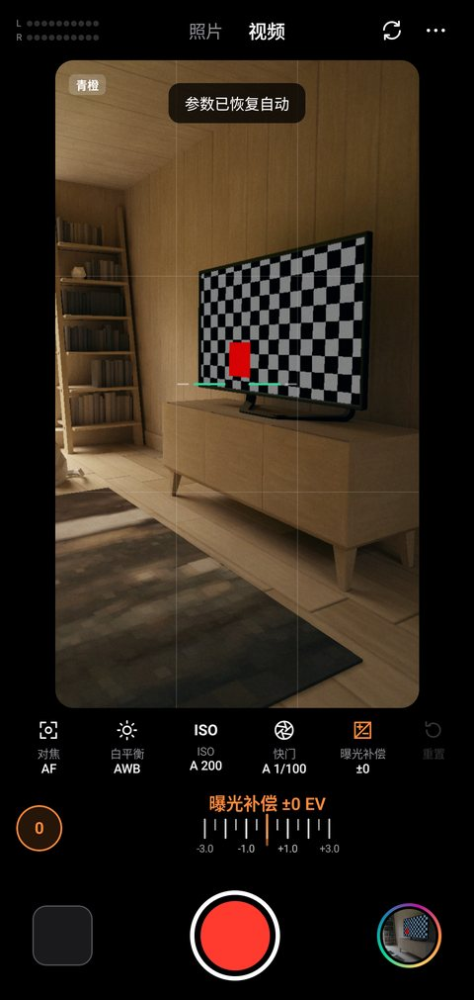 |

工具栏最右侧的 **重置**：

- 对焦、白平衡、ISO、快门、曝光补偿恢复为自动，色温和色调回到默认值，同时取消点击对焦锁定的对焦 / 测光区域；
- 变焦、补光、防抖保持不变；
- 所有参数都处于自动时置灰。

影调强度与胶片效果的重置在影调面板标题栏，见[影调](#影调)。

### 监看辅助

| 斑马纹 | 峰值对焦 | 波形图 | 设置：辅助 |
|:---:|:---:|:---:|:---:|
| 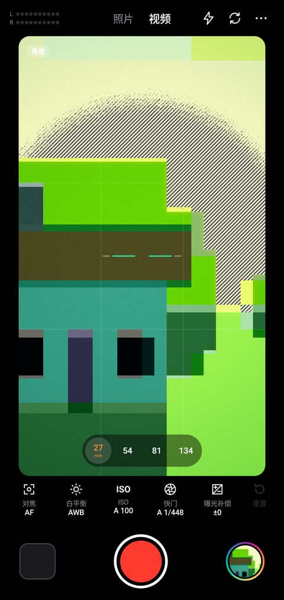 | 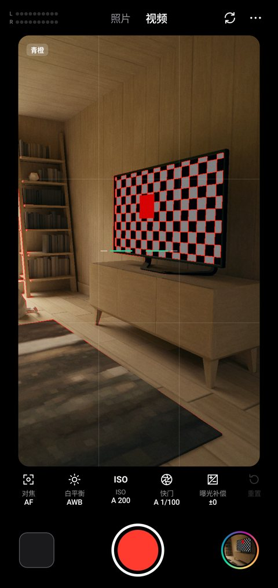 | 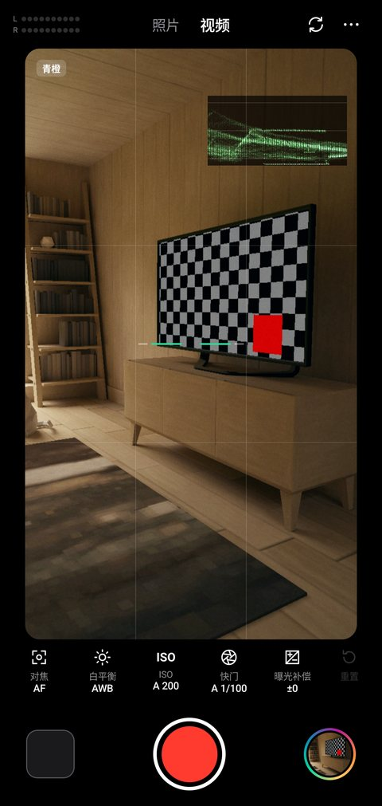 | 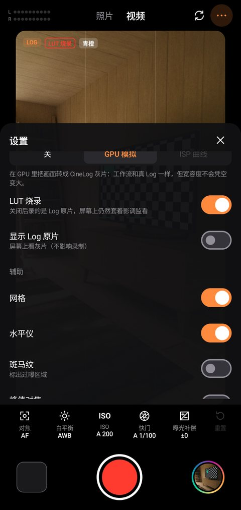 |

在 **设置 → 辅助** 中开关。监看辅助只画在屏幕上，不会进入录像和照片。

| 功能 | 说明 |
|---|---|
| 网格 | 三分线 |
| 水平仪 | 中线始终与地平线平行，偏差小于 1° 时变绿 |
| 斑马纹 | 用斜纹标出亮度 ≥ 95% 的区域，提示过曝 |
| 峰值对焦 | 合焦的边缘描红 |
| 波形图 | 右上角的亮度波形：横轴对应画面横向位置，纵轴为亮度 |

### 画幅、录像与拍照

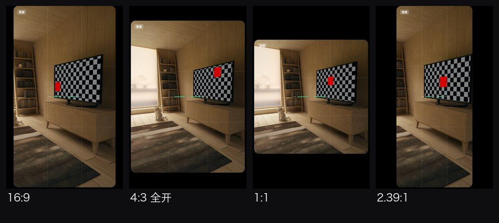

| 录制中 | 照片模式 | 成片示例 |
|:---:|:---:|:---:|
| 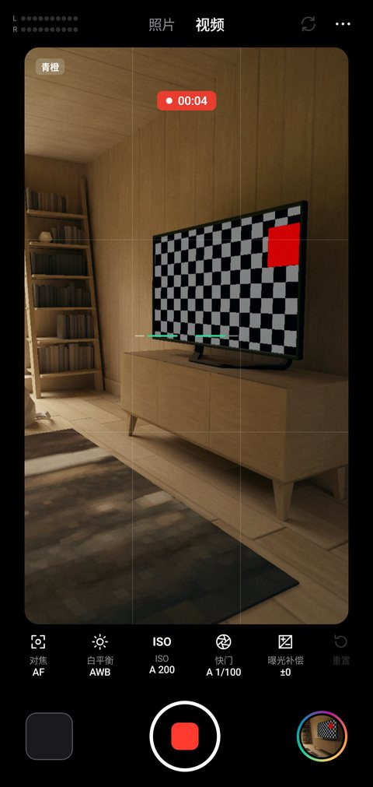 | 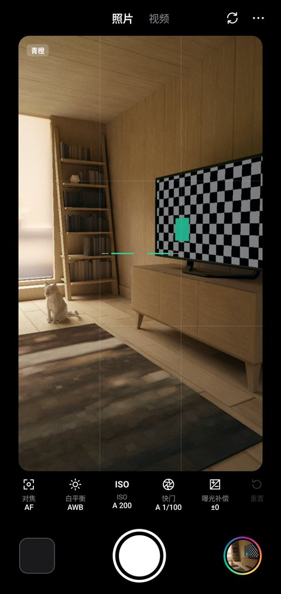 | 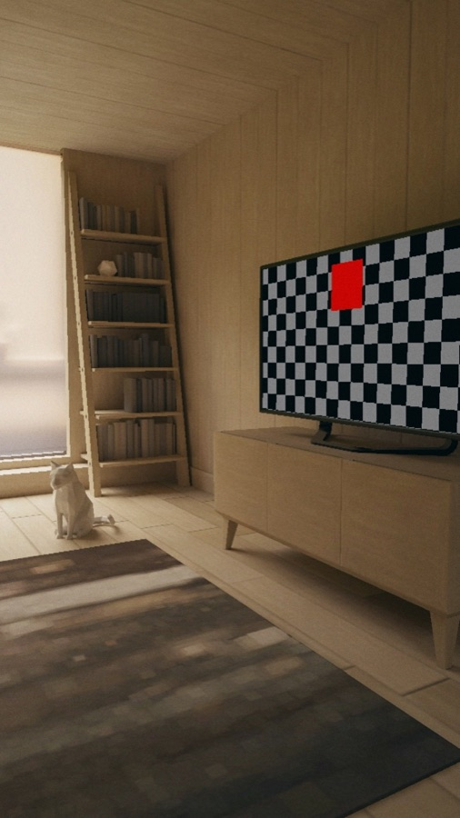 |

| 项目 | 说明 |
|---|---|
| 画幅 | 16:9、4:3 全开、1:1、2.39:1，预览、录像、拍照一致 |
| 录像 | H.264 + AAC；1080p / 4K，24 / 25 / 30 / 60 fps，按设备能力列出；音视频使用同一时钟对齐；竖拍写入旋转元数据 |
| 拍照 | 以 4:3 全幅 JPEG 拍摄，解码后在 GPU 上按全分辨率离屏处理（长边上限 4096），按所选画幅裁切，按设备朝向转正，写入 EXIF（ISO、快门、焦距、光圈） |
| 前置摄像头 | 预览镜像，成片不镜像 |
| 其他 | 常亮补光、防抖（`PREVIEW_STABILIZATION`，Android 13+ 且设备支持）、设置记忆 |
| 保存位置 | 系统相册 `DCIM/CineGL` |

## 构建与运行

环境要求：

- JDK 17
- Android SDK 36、NDK `27.1.12297006`、CMake `3.22.1`（均可在 Android Studio 的 SDK Manager 中安装）
- 设备：Android 11 及以上（minSdk 30），支持 OpenGL ES 3.0；工程只编译 `arm64-v8a`

```bash
# local.properties 中配置 sdk.dir（Android Studio 打开工程时会自动生成）
export JAVA_HOME=$(/usr/libexec/java_home -v 17)   # macOS；其他系统指向任意 JDK 17
./gradlew :app:installDebug
```

> Gradle 8.13 与 Kotlin 2.1 无法在 JDK 25 上运行。如果 Android Studio 自带的 JDK 是 25，请在 **Settings → Build, Execution, Deployment → Build Tools → Gradle** 中把 Gradle JDK 改为 17。

首次启动会申请相机与麦克风权限。未授予麦克风权限时，录像不带声音。

## 测试

| 命令 | 内容 | 运行环境 |
|---|---|---|
| `core/scripts/run_host_tests.sh` | C++ 核心单测：CineLog 曲线、色彩数学、影调烘焙、`.cube` 解析（含各类错误的错误码）、画面几何（裁切 / 旋转 / 镜像 / 输出方向）、pass 规划、着色器嵌入 | macOS / Linux，无需设备 |
| `core/scripts/validate_shaders.sh` | 展开 `#include` 后用 NDK 自带的 `glslc` 编译全部 GLSL，提前发现 uniform 重名、类型错误等问题 | macOS / Linux，无需设备 |
| `./gradlew :app:testDebugUnitTest` | Kotlin 单测：半自动曝光推算、一键重置、流尺寸选择、变焦预设、朝向吸附、点击对焦坐标换算、影调名随界面语言切换、双语文案检查（中英文的键与占位符一致，代码里没有硬编码的中文） | JVM |

## 架构

```
┌──────────────────────────── app（Kotlin）────────────────────────────┐
│  Compose UI  ──  CameraViewModel                                      │
│                    │            │               │             │       │
│           CameraController  RenderEngine   VideoRecorder  AudioCapture│
│             (Camera2)        (GL 线程)     (MediaCodec)   (AudioRecord)│
│                 │   Surface ▲   │  │ EGLSurface ▲               │       │
│                 └───────────┘   │  └────────────┘  PCM ─────────┘       │
│                                 │ JNI（CineCore.kt ↔ cinegl_jni.cpp）   │
└─────────────────────────────────┼──────────────────────────────────────┘
┌─────────────────────────────────▼──────────── core（C++）──────────────┐
│  Engine（GLES 3.0）：镜头 → 光晕/柔光 → 胶片 → 上屏 / 编码器 / 拍照读回 │
│  纯 CPU：Color（CineLog）· Looks · LutBaker · CubeLut · FrameGeometry · │
│          PassPlan · 着色器（编译期嵌入）                                 │
└────────────────────────────────────────────────────────────────────────┘
```

一帧的处理顺序：

```
相机 ─SurfaceTexture─▶ OES 纹理
   ─[镜头 input]──────▶ signal  （画幅裁切、色散、白平衡、暗角；开 Log 时编码为 CineLog）
   ─[光晕/柔光 glow]──▶ Dual Kawase 模糊金字塔（线性空间、半精度）
   ─[胶片 film]───────▶ graded  （叠加光晕/柔光 → 中性 LUT 与影调 LUT 混合 → 颗粒）
        ├─▶ 屏幕：圆角、峰值、斑马纹、波形图
        ├─▶ 编码器：按设备朝向旋转；LUT 烧录关闭时改用 signal
        └─▶ 影调缩略图：每个影调一格，拼成图集读回
```

拍照时，JPEG 解码后作为 2D 纹理走同一条管线，使用独立的一套全分辨率帧缓冲。

## 目录结构

| 路径 | 说明 |
|---|---|
| `core/include/cinegl/` | 核心的公开头文件（不含任何 GL 类型） |
| `core/src/color/` | 色彩数学、影调配方、LUT 烘焙、`.cube` 解析 |
| `core/src/geometry/` | 画面裁切、旋转 / 镜像矩阵、输出方向 |
| `core/src/pipeline/` | pass 规划、着色器库、GLES 引擎 |
| `core/src/gl/` | GL 对象封装（程序、帧缓冲、四边形、3D 纹理） |
| `core/shaders/` | GLSL ES 3.00 源码（编译期嵌入二进制） |
| `core/tests/` | 主机单测 |
| `app/src/main/cpp/` | JNI 桥 |
| `app/src/main/java/com/mycro/cinegl/render/` | EGL、GL 线程、LUT 调度 |
| `app/src/main/java/com/mycro/cinegl/camera/` | Camera2 封装、手动参数、测光坐标换算 |
| `app/src/main/java/com/mycro/cinegl/record/` | 录像、音频采集 |
| `app/src/main/java/com/mycro/cinegl/media/` | 写入系统相册 |
| `app/src/main/java/com/mycro/cinegl/ui/` | Compose 界面与 ViewModel |
| `app/src/main/res/values*/` | 界面文案：默认英文，简体中文在 `values-b+zh+Hans` |
| `docs/` | 原理与设计取舍、截图（英文界面截图在 `docs/images/en/`） |

## 截图说明

本文截图均来自 Android 模拟器，App 语言为简体中文（[英文版 README](README.en.md) 使用英文界面的截图）：

```bash
emulator -avd <AVD 名> -camera-back virtualscene -camera-front emulated
```

- 后置 `virtualscene` 是一个 3D 房间，LIMITED 级别：曝光固定，不支持手动 ISO / 快门 / 对焦 / 色调曲线，界面会把对应控件置灰。胶片效果和 Log 对比使用 4:3 画幅，是为了把窗户这块高光拍进画面。
- 前置 `emulated` 是色块动画，FULL 级别，可以验证手动参数与半自动曝光。「手动 ISO」和「斑马纹」两张截图来自前置摄像头。`ISP 曲线` 的请求能下发，但模拟传感器不会把曲线作用到像素上，效果需要真机验证。
- 模拟器上 GPU 管线与编码较慢，录像帧率明显低于真机。

## 已知限制

- 闪光灯只提供常亮补光，没有拍照瞬间闪光（需要实现 AE 预闪流程）。
- 未实现动态照片（实况）。
- `ISP 曲线` 依赖设备支持 `TONEMAP_MODE_CONTRAST_CURVE`。ISP 输出前线性值已被截断在 1.0，Log 曲线改变的是编码方式（暗部更多码值、高光更平缓），宽容度上限仍由传感器决定。
- 手动白平衡是相对于「切换到手动时 AWB 的结果」按 5500K 基准偏移，不是绝对色温。
- 管线中间帧缓冲为 RGBA8（光晕金字塔在支持时为 RGBA16F），大幅度调色时可能出现色带。
- 录像仅支持 H.264；拍照长边上限 4096。

## 进一步阅读

- [docs/原理与设计取舍.md](docs/原理与设计取舍.md)：每一步为什么这样做、踩过的坑和放弃的方案，附练习题。英文版见 [docs/design-notes.md](docs/design-notes.md)。
