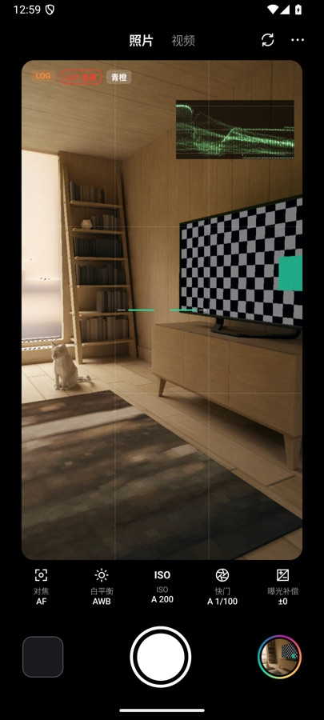
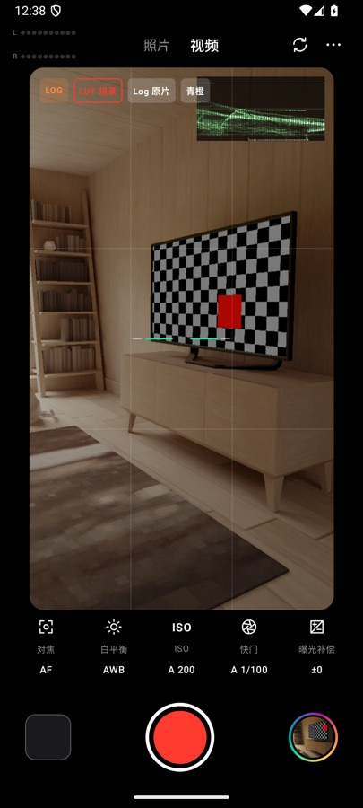

# CineGL（Android）

电影感相机 App，同时也是一个 **OpenGL ES 3.0 渲染滤镜** 的学习项目：相机画面经过一条完整的 GPU 管线（镜头 → 胶片曝光 → 冲洗调色 → 颗粒），实时显示、录像、拍照共用同一套渲染。

渲染核心用 C++ 编写（`core/`），可以脱离手机在电脑上单测；Android 壳层（`app/`）负责 Camera2、EGL、MediaCodec 与 Compose 界面，通过一层很薄的 JNI 调用核心。

| 取景 | 影调面板 | Log 原片 + 波形图 | 手动 ISO |
|:---:|:---:|:---:|:---:|
|  |  |  |  |

> 截图来自 Android 模拟器的虚拟场景摄像头。

## 功能

| 模块 | 内容 |
|---|---|
| 影调 | 11 个内置影调（3D LUT，33³），强度 0–10 连续可调；支持导入 `.cube`（3D LUT），重启后自动加载；影调面板显示每个影调作用在实时画面上的缩略图 |
| 胶片效果 | 光晕（halation）、柔光（diffusion）、颗粒、颗粒大小、暗角、色散，均为 0–10 连续值 |
| Log | `GPU 模拟`：在 GPU 内把画面转换为 CineLog 曲线；`ISP 曲线`：通过 `TONEMAP_CURVE` 让相机 ISP 直接输出 CineLog（需设备支持 `TONEMAP_MODE_CONTRAST_CURVE`）。**LUT 烧录**开关：关闭时写入文件的是 Log 原片，屏幕仍套用影调监看；可切换显示 Log 原片 |
| 手动参数 | ISO、快门（可单独锁定任一项 = 半自动曝光）、曝光补偿、手动对焦、白平衡（色温 + 色调）、点击对焦测光、长按恢复连续对焦、双指缩放与变焦预设（显示 35mm 等效焦距） |
| 监看辅助 | 网格、水平仪、斑马纹、峰值对焦、亮度波形图（只画在屏幕上，不进入成片） |
| 拍照 | 4:3 全幅 JPEG 解码后在 GPU 上以全分辨率离屏处理，按设备朝向转正，写入 EXIF（ISO、快门、焦距、光圈） |
| 录像 | H.264 + AAC，1080p / 4K（取决于设备），24 / 25 / 30 / 60 fps（取决于设备），画幅 16:9、4:3 全开、1:1、2.39:1；音视频使用同一时钟对齐；竖拍写入旋转元数据 |
| 其他 | 常亮补光、前后摄切换、防抖（`PREVIEW_STABILIZATION`，Android 13+ 且设备支持时）、L/R 电平表、设置记忆 |

## 环境要求

- JDK 17
- Android SDK 36、NDK `27.1.12297006`、CMake `3.22.1`（均可在 Android Studio 的 SDK Manager 中安装）
- 设备：Android 11 及以上（minSdk 30），支持 OpenGL ES 3.0；工程只编译 `arm64-v8a`

## 构建与运行

```bash
# local.properties 中配置 sdk.dir（Android Studio 打开工程时会自动生成）
./gradlew :app:installDebug
```

首次启动会申请相机与麦克风权限。未授予麦克风权限时，录像不带声音。

## 测试

| 命令 | 内容 | 运行环境 |
|---|---|---|
| `core/scripts/run_host_tests.sh` | C++ 核心单测：CineLog 曲线、色彩数学、影调烘焙、`.cube` 解析、画面几何（裁切/旋转/镜像/输出方向）、pass 规划、着色器嵌入 | macOS / Linux，无需设备 |
| `core/scripts/validate_shaders.sh` | 展开 `#include` 后用 NDK 自带的 `glslc` 编译全部 GLSL，提前发现 uniform 重名、类型错误等问题 | macOS / Linux，无需设备 |
| `./gradlew :app:testDebugUnitTest` | Kotlin 单测：半自动曝光推算、流尺寸选择、变焦预设、朝向吸附、点击对焦坐标换算 | JVM |

## 架构

```
┌──────────────────────────── app（Kotlin）────────────────────────────┐
│  Compose UI  ──  CameraViewModel                                      │
│                    │            │               │             │       │
│           CameraController  RenderEngine   VideoRecorder  AudioCapture│
│             (Camera2)        (GL 线程)     (MediaCodec)   (AudioRecord)│
│                 │   Surface ▲   │  │ EGLSurface ▲               │       │
│                 └───────────┘   │  └────────────┘  PCM ─────────┘       │
│                                 │ JNI（CineCore.kt ↔ cinegl_jni.cpp）   │
└─────────────────────────────────┼──────────────────────────────────────┘
┌─────────────────────────────────▼──────────── core（C++）──────────────┐
│  Engine（GLES 3.0）：镜头 → 光晕/柔光 → 胶片 → 上屏 / 编码器 / 拍照读回 │
│  纯 CPU：Color（CineLog）· Looks · LutBaker · CubeLut · FrameGeometry · │
│          PassPlan · 着色器（编译期嵌入）                                 │
└────────────────────────────────────────────────────────────────────────┘
```

一帧的处理顺序：

```
相机 ─SurfaceTexture─▶ OES 纹理
   ─[镜头 input]──────▶ signal  （画幅裁切、色散、白平衡、暗角；开 Log 时编码为 CineLog）
   ─[光晕/柔光 glow]──▶ Dual Kawase 模糊金字塔（线性空间、半精度）
   ─[胶片 film]───────▶ graded  （叠加光晕/柔光 → 中性 LUT 与影调 LUT 混合 → 颗粒）
        ├─▶ 屏幕：圆角、峰值、斑马纹、波形图
        ├─▶ 编码器：按设备朝向旋转；LUT 烧录关闭时改用 signal
        └─▶ 影调缩略图：每个影调一格，拼成图集读回
```

拍照时，JPEG 解码后作为 2D 纹理走同一条管线，使用独立的一套全分辨率帧缓冲。

## 目录结构

| 路径 | 说明 |
|---|---|
| `core/include/cinegl/` | 核心的公开头文件（不含任何 GL 类型） |
| `core/src/color/` | 色彩数学、影调配方、LUT 烘焙、`.cube` 解析 |
| `core/src/geometry/` | 画面裁切、旋转/镜像矩阵、输出方向 |
| `core/src/pipeline/` | pass 规划、着色器库、GLES 引擎 |
| `core/src/gl/` | GL 对象封装（程序、帧缓冲、四边形、3D 纹理） |
| `core/shaders/` | GLSL ES 3.00 源码（编译期嵌入二进制） |
| `core/tests/` | 主机单测 |
| `app/src/main/cpp/` | JNI 桥 |
| `app/src/main/java/com/mycro/cinegl/render/` | EGL、GL 线程、LUT 调度 |
| `app/src/main/java/com/mycro/cinegl/camera/` | Camera2 封装、手动参数、测光坐标换算 |
| `app/src/main/java/com/mycro/cinegl/record/` | 录像、音频采集 |
| `app/src/main/java/com/mycro/cinegl/media/` | 写入系统相册 |
| `app/src/main/java/com/mycro/cinegl/ui/` | Compose 界面与 ViewModel |
| `docs/` | 原理与设计取舍、截图 |

## 在模拟器上验证

```bash
emulator -avd <AVD 名> -camera-back virtualscene -camera-front emulated
```

- 后置 `virtualscene`（3D 房间）为 LIMITED 级别，不支持手动 ISO / 快门 / 对焦 / 色调曲线，界面会将对应控件置灰。
- 前置 `emulated`（彩色色块）为 FULL 级别，可验证手动参数与半自动曝光。`ISP 曲线` 的请求可以下发，但模拟传感器不会把曲线作用到像素上，需要真机验证效果。
- 模拟器上 GPU 管线与编码较慢，录像帧率明显低于真机。

## 已知限制

- 闪光灯只提供常亮补光，没有拍照瞬间闪光（需要实现 AE 预闪流程）。
- 未实现动态照片（实况）。
- `ISP 曲线` 依赖设备支持 `TONEMAP_MODE_CONTRAST_CURVE`。ISP 输出前线性值已被截断在 1.0，Log 曲线改变的是编码方式（暗部更多码值、高光更平缓），宽容度上限仍由传感器决定。
- 手动白平衡是相对于「切换到手动时 AWB 的结果」按 5500K 基准偏移，不是绝对色温；设备支持 `MANUAL_POST_PROCESSING` 时在 ISP 中调增益，否则在 GPU 中调整。
- 管线中间帧缓冲为 RGBA8（光晕金字塔在支持时为 RGBA16F），大幅度调色时可能出现色带。
- 录像仅支持 H.264；拍照长边上限 4096。

## 进一步阅读

- [docs/原理与设计取舍.md](docs/原理与设计取舍.md)：每一步为什么这样做、踩过的坑和放弃的方案，附练习题。
